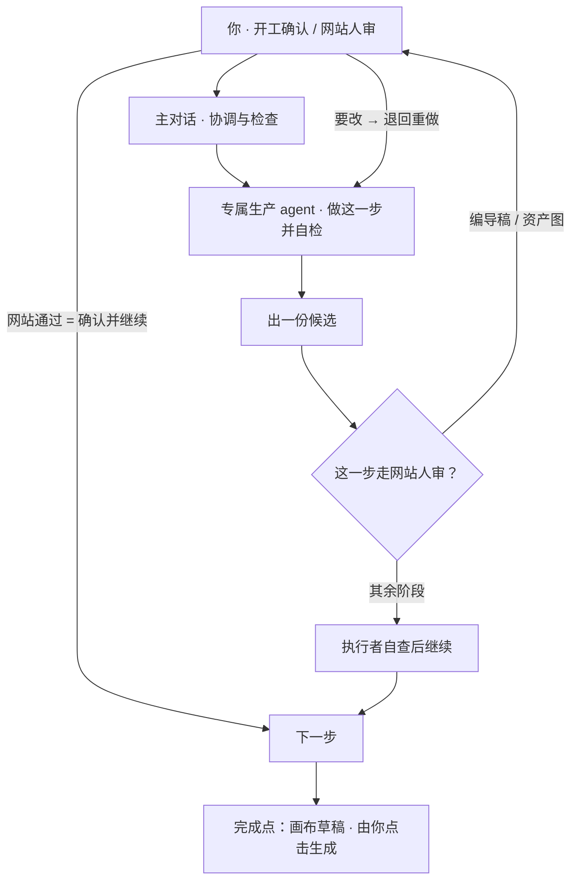

# 项目蓝图（北星文档）

> 这个项目的「为什么 + 往哪走」：方向与取舍的参考图，**不是规则正文，也不是开工必读清单**。
> 进入项目的读取顺序以 `AGENTS.md` 为准：先读 `PROJECT_RULES.md` 与目标 Skill 的 `SKILL.md`。本蓝图只在需要展开「方向」时对照阅读；与 `PROJECT_RULES.md` 不一致时，以 `PROJECT_RULES.md` 及其链接细则为准。
> 流程与执行分工不在本蓝图维护正文：默认流程见 `PROJECT_RULES.md`「网站审核到画布的统一入口」，执行分工见 `docs/rules/execution.md`「Skill 执行分工」。

## 一、这是什么

- 它是**你个人做 AI 短剧的工具**：把一个故事 → 分镜 → 资产 → 视频脚本 → 成片。
- 它**不是一个框架**：不追求功能全、不做通用平台、**不为「维护工具本身」而存在**。
- 一句话：**顺手、轻、能出片。** 只有你一个用户，你的手感就是标准。

## 二、核心（拍片之路，永远优先保留）

执行分工不在本蓝图复述：每一步由谁执行、如何自查，以 `docs/rules/execution.md`「Skill 执行分工」为准；本节只列步骤与产出。

| 步 | Skill | 产出 |
|---|---|---|
| 0 | `init_desktop_project` | 建 9 目录 + project_state.json |
| 1 | `creative-director` 编导 | 叙事 JSON（Markdown 按需导出） |
| 2 | `storyboard-planner` 分镜 | 导演 JSON（Markdown 按需导出） |
| 3 | `blender-previs` 预演（可选·已有 runner，按当前配方验收） | Blender 预演 |
| 4 | `asset-image-assistant` 资产 | 人物/场景/道具/产品母版图 |
| 5 | `voice-reference-manager` 声音（可选·已有导入/绑定 CLI，按当前输入验收） | 声音参考库 |
| 6 | `storyboard-director` 画面（按需） | 正式分镜图 |
| 7 | `voiceover-to-video-script` 视频脚本 | 已确认导演包、原文对白与真实素材 → 完整分段 JSON 提示词（Markdown 按需导出） → 画布草稿（由你点击生成） |

- **每步之间**：除 `voiceover-to-video-script` 外使用 `stage_context_cli` 的 `prepare` / `ensure-prepared` / `review-pack` / `handoff` / `validate`（入口全集以 `PROJECT_RULES.md`「工作边界」为准）；视频提示词按其 Skill 入口直接读取和自查。
- **生产与审核**：默认流程（哪些阶段走网站人工审核、通过后如何流转、完成点在哪）以 `PROJECT_RULES.md`「网站审核到画布的统一入口」为准，不在本蓝图复述；独立审核只在用户明确要求时启动，返修回当前执行者，复审回原审核者。

### 运行流程（一图看懂）

> 一大步怎么切成上面这几步、每一部的产出是什么，见上方**步骤表**；每个 Skill 的具体职责与产出见 `skills/<skill>/SKILL.md`。

## 三、边界（什么不碰 / 不主动加）

「**只加帮出片的东西**」。以下属工程性 / 治理性重量，**不主动加，除非直接挡着你出片**：

- 大型测试套件（按改动风险保留最小充分的核心测试，不固定数量）。
- 冗余格式合同 / 多版本 schema。
- 治理 / 审核规范**制度**（安全红线保留，制度性流程不加）。
- 多 agent 运行时 / 黑箱调度引擎 / 架构重构层。
- 为「别的项目 / 通用场景」准备的东西（一次性、写死某个项目的除外）。

## 四、决策标准（拿不定时按顺序问自己）

1. 它**让你更快把这部片子做出来**吗？ 是 → 考虑加；否 → 默认不加。
2. 它是在**维护工具本身**（防回归 / 可维护性 / 通用性）吗？ 是 → 这是工程性重量，警惕。
3. 有**更轻、更少**的做法吗？ 有 → 选轻的。宁缺一个功能，不让项目回重。
4. 这会让项目**更难被你一个人用**吗？ 会 → 不做。
5. 与「方向段 / 安全红线」冲突吗？ 冲突 → 不做。

## 五、明确删掉的（别加回来）

- 冗余 schema：`production-plan-v3.1`、`artifact-manifest`、`project-state`、`knowledge-rule`。当前 `review-profile` 是按需审核的最小清单，不在删除范围。
- `production_plan` 整条路径已退役（现行视频阶段不生成）：`core/production_plan.py`、`scripts/validate-production-plan.py` 与两个 schema 仍在，**只用于读旧项目**，别再往新项目接线。
- 死脚本 + `scene_topology` 引擎 + `core/archive`、2 个一次性脚本。
- 历史上删除了 29 个冗余测试、保留 8 个核心；该数量是历史记录，不是后续上限。
- `sync-log`、死模板、`visual-benchmarks`、13 个空 `references` 脚手架。
- 治理规范细节 + 生产/空白对话分割的繁文缛节（安全红线和原生空白子 agent 隔离保留，见 `docs/rules/execution.md` 的执行分工）。

## 六、安全红线（保护你的东西）

五条红线见 **[PROJECT_RULES.md](../PROJECT_RULES.md)**，此处不重复，避免两处同步漂移。

## 七、怎么用这份蓝图

- 想改 / 加东西：先按 `PROJECT_RULES.md` 判断能不能做，再用本蓝图「三、边界」「四、决策标准」对照方向与取舍。
- **技术决策记录见 [docs/decisions.md](decisions.md)**：记的是"为什么这么定 + 否掉了什么"，是历史与理由参考，查阅可避免走回头路 / 重新发明；其中条目与现行规则冲突时以现行规则为准（条目末尾有现行状态注的以注为准）。
- 它和 PROJECT_RULES「方向」段一致；本蓝图是更详细的一张图。
- **你（唯一用户）有最终决定权。** 蓝图帮你和 AI 保持同一条线，不替你拍板。
