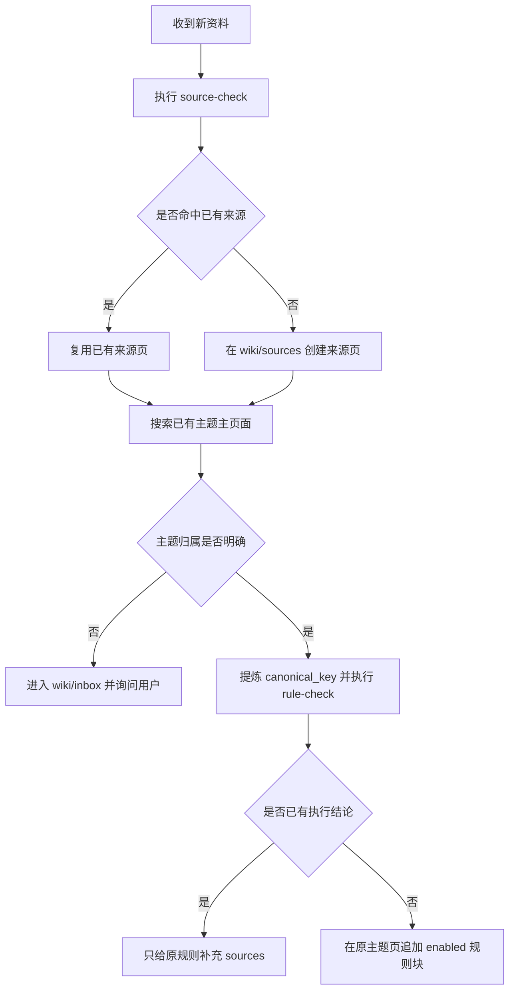

# Master-Storyboarding 知识接入与生产反馈规则

> [!abstract] 核心原则
> 来源页负责保存“资料说了什么”，不拥有项目执行权。能够明确转译为执行方法的新知识，去重后直接写入已有主题主页面，并以 `status=enabled` 参与真实生产；用户通过真实交付检查效果。重复结论只补充来源，不创建第二个执行入口。

## 适用范围

本页只适用于明确属于 Master-Storyboarding 的知识摄入、规则去重、生产使用、问题溯源与无效规则处理，不扩大为其他项目的通用例外。

相关设计与实施记录：《2026-08-22 知识库动态联动与生产反馈治理设计》与《2026-08-22 Master-Storyboarding 动态知识路由实施计划》两份原文档已随项目层清理移除，本库不再保留其正文；目录职责与边界见 [[wiki/reference/知识库目录职责与项目边界]]。

## 视频提示词固定读取例外（2026-09-10）

用户已确认 `voiceover-to-video-script` 采用三层结构：项目本地 Skill 承担流程与技术合同，`projects/Master-Storyboarding/应用知识/` 保存明确绑定的专项方法，经验按已登记入口选择相关内容。分流标准、写入路径和升级边界见 [[projects/Master-Storyboarding/三层知识分流与写入规则]]。视频提示词固定绑定三份方法：提示词基础方法、素材职责与引用方法，以及仅在本轮明确选择 `seedance2.5` 时读取的 Seedance 2.5 受限表达与控制引用。当前方法入口见 [[projects/Master-Storyboarding/应用知识/视频提示词/索引]]。

本页涉及 topics 动态选择、`stage_startup.md`、方法阅读包及阅读声明的生产要求不适用于该 Skill；它按 `knowledge-profile.json` 的明确文件绑定与适用条件直接读取正文，交付时简记实际方法版本。旧 `MSB-KB-VGEN-002`、其他旧动态块和 `.evolving` 页面均不是该 Skill 的读取目标。其他 Skill 保持各自现行入口，不因本试点迁移或切换。维护时仍核对来源、重复结论、文件链接与适用边界，读取方法不自动改写方法，经验不覆盖已确认导演决定。

## 固定接入顺序



必须依次执行：

1. 先运行 `source-check`，使用规范化网址、`source_id` 或 `content_hash` 检查来源是否已存在。
2. 任一来源键命中时复用同一来源页；均未命中时才在 `wiki/sources/` 创建新来源页。
3. 搜索知识库中已有的主题主页面。已有同一主题时，让原页面继续生长，不另建“新版”“主题 2”等同义页面。
4. 从新内容提炼稳定的 `canonical_key`，再运行 `rule-check` 检查同一执行结论是否已有活动规则。
5. 已有相同执行结论时，只在原规则的 `sources` 中增加来源，不重复写正文，也不创建第二个规则块。
6. 确有新的可执行方法时，在原主题主页面追加一个 `status=enabled` 的完整规则块。
7. 无法判断项目或主题归属时，写入 `wiki/inbox/`，并向用户询问归属；不得自行猜测。
8. 写入可执行知识时必须同时裁定生产入口：继续演化并按需生效的规则使用 `authority=wiki`；需要逐字遵守、随 Skill 版本冻结的规则使用 `authority=repo`，并先在项目仓库建立本地指南、模板、硬规则或验证器载体。
9. `authority=repo` 规则必须在项目 `references/workflow/knowledge-entrypoints.json` 登记本地载体、消费 Skill 和关键执行词；Skill 对本地合同的直接文件引用是唯一参考路由真相。只有知识库正文、没有真实载体与 Skill 引用，视为未完成接入。
10. 完成前手动运行生产入口审计；存在 Skill profile 非法、topic 不可达、来源缺失、本地载体缺失、直接引用断链、关键执行词缺失或旧中央路由残留时，不得声称知识已经进入项目。

## 只读检查方式

`source-check` 与 `rule-check` 是知识维护步骤，不再承诺一个会修改状态的中央管理 CLI。维护者应使用 Obsidian 搜索或只读全文检索，分别检查规范化网址、`source_id`、`content_hash` 与 `canonical_key`；搜索结果只用于判断复用位置，不会自动创建、合并或删除笔记。

## 来源页与执行规则的边界

来源页可以重复表达同一观点，因为它们分别保存证据和出处；生产上下文不能因此重复执行同一个结论。

| 内容 | 保存位置 | 是否拥有执行权 |
|---|---|---|
| 原始资料及附件 | `raw/` | 否 |
| 单份资料摘要与出处 | `wiki/sources/` | 否 |
| 主题主页面中的有效 `msb-knowledge` 规则块 | `wiki/concepts/` 或明确的项目主题页 | 是 |
| 模糊观察与未形成方法的假设 | 对应 `.evolving.md` | 否 |
| 暂时无法归类的内容 | `wiki/inbox/` | 否 |
| 已删除规则的极简冷记录 | `wiki/reference/master-storyboarding-invalid-rules.jsonl` | 否 |  <!-- link-check: ignore -->

## 规则块写入要求

新方法必须作为一条可独立理解、应用和删除的完整规则写入。它至少应具有唯一 `rule_id`、稳定 `canonical_key`、消费 Skill 名单 `stages`、检索 `topics`、`status=enabled`、`sources` 与正文，不把同一方法拆成必须同时加载的零碎句子。为兼容现有规则块，字段名仍为 `stages`，但值必须是真实 Skill 名，不再表示旧状态机阶段。

`enabled` 表示规则已经可以参与真实项目，不表示它已经被证明绝对正确。只有用户明确认可时，才把状态改为 `confirmed`。

### 生产入口硬门禁

知识块的 `authority` 不是来源标签，而是生产入口选择：

- `authority=wiki`：规则正文由当前 Skill 的 `knowledge-profile.json` topics、明确任务触发、项目范围、规则优先级和状态共同选择，进入 `stage_startup.md`；Skill 不扫描整个 Vault，也不复制知识正文。
- `authority=repo`：动态选择不加载该 Wiki 规则正文；项目仓库中的稳定合同载体必须成为真实执行入口，并被消费 Skill 直接引用。
- 来源页、`.evolving.md`、项目记录和设计报告不直接拥有生产执行权，不得仅因正文“看起来有用”就自动载入。

持续审计命令：

```powershell
python C:\Users\LIUYANG\Documents\Master-Storyboarding\scripts\audit-knowledge-entrypoints.py --vault "C:\Users\LIUYANG\Documents\Obsidian Vault"
```

该审计是知识维护的确定性门禁，只在新增或修改可执行知识、topics、Skill profile、本地合同或执行入口后手动运行。它不接入普通 `prepare`，不参与每次生产任务，也不增加阶段冷启动成本。

## `.evolving.md` 的使用边界

明确可执行的新知识不经过 `.evolving.md`，而是直接在主题主页面新增 `enabled` 规则块。

以下内容仍进入 `.evolving.md`：

- 尚不能形成可执行结论的观察；
- 只有模糊相关性、无法声明适用范围的假设；
- 暂不准备进入任何项目的探索内容。

`.evolving.md` 不进入生产上下文，因此它用于保留思考，不承担规则正确性验证。

## 生产反馈与无效规则处理

当交付出现问题时，先沿“产物位置 → 本轮采用规则 → 主题页面 → 来源页”溯源。只有确认问题由某条规则导致后，才执行无效化：

1. 预览目标规则、当前指纹、来源与受影响产物。
2. 用户确认后，从主题主页面删除这一完整规则块。
3. 保留来源页，不修改资料原意。
4. 写入不含规则正文的极简冷记录，防止同一无效结论再次自动摄入。
5. 后续动态选择不再加载该规则；已经由用户确认定稿的历史项目不自动返工。

如果只能判断“疑似相关”而不能确认因果，不直接删除规则，继续溯源。

## 上下文控制

项目运行时只加载与当前 Skill、主题、明确任务触发和风险匹配的少量规则块，不加载来源历史、探索笔记或冷删除记录。多个来源支持同一 `canonical_key` 时，规则正文仍只出现一次；来源关系留在后台清单用于追溯。

## 当前生产模式

Master-Storyboarding 当前采用 profile 驱动的有界启动包：

- 每个 Skill 只声明职责内 topics；选择顺序为明确任务触发、主题相关度、规则优先级、状态；
- 全局最多 8 个知识块、6000 字符、单块 1800 字符；单块超过剩余预算时跳过该块并继续选择后续合适内容；
- `confirmed` 规则在冲突时优先；两个 `confirmed` 规则冲突时阻塞并报告；
- 项目硬红线、Skill 硬红线、产品参考与用户约束进入固定启动核心，不参与动态知识竞争；
- `stage_startup.md` 是当前阶段的知识入口；不再维护旧阶段总表、`knowledge_context.md` 或 feature flag 路由。
