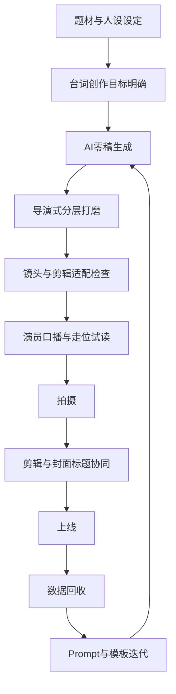

# 如何写出适合抖音短视频平台的短剧台词

## 执行摘要

这份报告的核心结论是：**适合抖音的短剧台词，不是把传统影视对白“缩短”，而是把“信息密度、情绪密度、冲突密度和镜头可执行性”同时抬高**。抖音端的微短剧流量逻辑显示，用户首先常常是被“剧情片段”吸引进入作品；而真正驱动持续观看的，不只是爽感本身，而是**紧凑连贯的主线、出其不意的反转、低理解门槛、贴近生活与高共鸣**。这一点决定了短剧台词必须先服务“抓人”，再服务“人物”，最后服务“美学”。 citeturn7view0turn6view0turn13search17

从导演技法上看，所谓“好莱坞级导演式台词打磨”，并不等于堆砌高级辞藻，而是把不同导演擅长的机制拆开：昆汀·塔伦蒂诺擅长用**闲谈制造威胁和角色辨识度**；克里斯托弗·诺兰擅长把**世界规则、情绪动机和结构信息合并进对白**；史蒂文·斯皮尔伯格及其常见编剧合作范式更强调**对白为动作与表演让路**；艾伦·索金则把对白当成**节奏与音乐**来控制观众注意力。把这些方法直接搬进抖音会失真，但如果改写成“前置钩子、句内冲突、三拍反转、可剪辑停顿、可复用口头标签”，就会非常有效。 citeturn38view0turn39view0turn16view1turn37view0turn37view1turn24search13turn40view0turn43search5turn41view0

基于抖音端原生微短剧数据，当前高频题材集中在**逆袭、家庭伦理、现言甜宠**，而悬疑推理虽然规模更小，但具备差异化突破空间；从样本榜单看，端原生老剧长尾效应明显，说明“可复述的台词钩子”和“强情节点复利”比一次性的华丽金句更重要。与此同时，免费微短剧用户结构正年轻化，40岁以下占比已突破50%，但女性偏好度依然更高，这意味着情感、关系和身份冲突仍然是更稳的台词底盘。 citeturn47view1turn48view1turn48view2turn49view0

在 AI 流程上，最有效的做法不是一次性“求一个好剧本”，而是建立**导演式反馈回路**：先用结构化提示词生成粗稿，再按“钩子、角色、节奏、镜头、可剪辑性、评论触发点”做多轮重写；把提示词写成含有**身份、指令、示例、上下文**的稳定模板，并在每次改动前后做小样本评测。OpenAI 的官方提示工程与评测文档也明确强调，提示应结构化、带示例、与上下文绑定，并通过代表性测试与评估迭代，而不是只凭主观感觉改 prompt。 citeturn29view1turn31view0turn31view2turn33view0turn33view3

因此，如果把这份报告压缩成一句可执行的原则，那就是：**抖音短剧台词 = 中文语境下的强情节句法 + 好莱坞级的节奏控制与人物动机 + AI 驱动的多轮导演式精修**。原创内容在微短剧用户中也比 IP 改编更受偏好，因此真正有效的路径不是模仿某位导演口吻，而是**提炼其方法，再重写为端原生中文短剧语言**。 citeturn6view1turn45view0

## 研究方法与边界

本报告采用四类材料交叉验证。其一，是中国微短剧行业与抖音端原生数据，包括中国网络视听协会相关公开摘要、深圳市政府对官方行业报告的政策解读、DataEye 与艾瑞咨询的行业报告，以及对抖音端原生微短剧榜单、题材分布、用户画像的公开数据整理。其二，是短视频注意力与竖屏叙事相关学术研究，用于解释“为什么这些台词结构在竖屏端更有效”。其三，是公开可检索的抖音热门短剧片段文案、搜索索引文本与榜单样本，用来观察端原生热剧的实际抓人方式。其四，是经典好莱坞剧本与创作者访谈，用于拆解导演级台词打磨的可迁移机制。 citeturn45view0turn46view0turn6view0turn7view0turn44view0turn44view1turn44view3turn38view0turn16view1turn36view1turn40view0turn41view0turn43search5

需要说明的边界有三点。第一，用户未指定具体受众年龄、地域与题材，因此本报告将目标受众设为**中文互联网泛短剧用户**，题材假设为**通用情感、喜剧、悬疑**三类。第二，抖音热视频的“完整官方剧本”通常难以公开获取，因此样本分析中的短剧台词片段，部分采用**公开可检索的片段文案、视频标题、剧情片段描述与平台索引文本**作为“端原生台词线索”，其价值在于反映平台上真正被传播的“第一抓手”，而非严格等同于拍摄脚本全文。第三，报告中的 AI 参数、流程和 KPI 阈值，部分属于面向实操的**推荐性方法**，不是平台公开硬标准；凡属于行业事实或已有研究结论的部分，均给出来源。 citeturn11search17turn11search27turn34search3turn35search7turn52search3turn29view1turn31view0

样本池的构成如下表所示。

| 样本类型 | 来源 | 用途 |
|---|---|---|
| 抖音端原生题材分布与 TOP20 榜单 | DataEye《2025年H1微短剧行业数据报告》 citeturn46view0turn47view1turn48view1turn48view2turn49view0 | 判断抖音当前高频题材、长尾效应与用户结构 |
| 用户动机与观看触达路径 | 艾瑞咨询相关行业报告截图页 citeturn6view0turn6view1turn7view0 | 反推台词的入口设计与认知负荷要求 |
| 竖屏与短视频注意力研究 | 学术论文与心理学研究 citeturn44view0turn44view1turn44view3 | 解释竖屏沉浸、陪伴式在场、持续注意消耗 |
| 好莱坞剧本样本 | 《Pulp Fiction》《Inception》《Schindler’s List》《The Social Network》及相关访谈 citeturn38view0turn39view0turn16view1turn37view0turn36view1turn37view1turn40view0turn41view0turn43search5 | 提炼导演/编剧级台词打磨机制 |
| AI 提示工程与评测 | OpenAI 官方文档 citeturn29view1turn31view0turn31view2turn33view0turn33view3 | 建立“提示词—评测—重写”的导演式反馈回路 |

## 平台与受众洞察

抖音语境下的微短剧，首先是一个**被片段驱动发现**的内容类型，而不是一个被用户主动规划消费的传统剧集。艾瑞的用户调研显示，用户接触微短剧最主要的方式是“刷视频时被剧情片段吸引”，占比达 63.3%；从观看渠道看，短视频平台和短剧小程序占主导，其中短视频平台占 37.5%，短剧小程序占 31.6%。这意味着台词的第一职责并不是完整叙事，而是**把用户从滑走状态拽进剧情状态**。换句话说，短剧台词在抖音里先是广告位，再是对白位。 citeturn7view0

从用户观看心理看，微短剧最主要的诉求包括娱乐消遣、缓解疲惫、拓展眼界与代入体验，而最能吸引观看的因素依次集中在**主线紧凑连贯、多层反转、简单易懂、单集耗时短、贴近生活、悬念设计和情感共鸣**。这组数据非常直接地说明：抖音短剧台词不应追求“文学的复杂”，而应追求**信息的直达、情绪的提前和关系的立刻清晰**。如果一句台词必须让观众回放才能听懂，那它在长片里可能成立，在抖音里通常已经输了。 citeturn6view0

具体到题材端，2025 年上半年抖音端原生微短剧中，**逆袭、家庭伦理、现言甜宠**位居前三；逆袭题材在投数量突破 2 万部，悬疑推理排到第 11 位，虽不是头部题材，但已具备规模化存在。热播榜 TOP20 也显示，逆袭和家庭伦理在前十中占比很高，且老剧持续贡献流量，说明可被复用的“身份差—羞辱—反击—反转确认”结构，依然是抖音端的基本燃料。 citeturn47view1turn48view1

用户画像方面，DataEye 的公开整理显示，免费微短剧在 2025 年 6 月的男性用户占比升至 52%，但女性用户偏好度仍然更高；年龄结构方面，40 岁以下占比已突破 50%，较上年同期提升明显。可以做出的合理推断是：**男性流量在扩大，女性驱动的关系戏仍在定义爆款语法**。因此，抖音短剧的台词设计更适合采用“双轴策略”：表层用身份、利益、胜负做钩子，深层用关系、委屈、认可与情感债做留存。 citeturn48view2turn49view0

从媒介形态上，竖屏之所以有效，并不只是因为手机握持方便。相关研究指出，竖屏视频与移动场景、沉浸式体验和“陪伴式在场”高度契合，能够强化面对面交流的感受与共情心理。另一项关于短视频成瘾与注意网络的研究则表明，短视频的高刺激、快速切换与即时反馈机制，容易消耗持续注意并削弱对无关信息的抑制能力。对于台词写作来说，这意味着一句对白如果在前半句没有给出足够强的目标、威胁或悬念，观众的大脑很可能在后半句之前就已经转移。 citeturn44view0turn44view1turn44view3

据此，适合抖音的台词必须遵守一条平台语法：**先给结果感，再给原因；先给关系，再给背景；先给威胁或羞辱，再给解释；先给能剪的情绪点，再给能演的心理层。** 这并不是降低表达质量，而是对平台注意力结构的顺应。与此同时，用户对原创剧集的偏好高于 IP 改编，也提醒创作者：你可以学习好莱坞的打磨方法，但不能让台词听起来像译制腔或小说腔。 citeturn6view1

下表把平台洞察转译为台词策略。

| 平台/用户事实 | 数据 | 对台词的直接要求 |
|---|---:|---|
| 用户多由剧情片段引流进入 | 刷视频被片段吸引占 63.3% citeturn7view0 | 开头一句必须可独立传播、脱离上下文也成立 |
| 用户偏好紧凑主线与反转 | 紧凑主线 40.9%，多层反转 40.9% citeturn6view0 | 每 7–12 秒至少给一个关系变化或信息翻面 |
| 用户偏好简单易懂 | 简单易懂 40.3% citeturn6view0 | 多用短句、动作句、对抗句，少用抽象解释句 |
| 用户偏好贴近生活与代入感 | 内容贴近生活 37.3%，情感共鸣 35.1% citeturn6view0 | 台词要像“会发生在家里、职场、电梯口”的冲突 |
| 抖音端原生高频题材为逆袭/家庭伦理/甜宠 | 题材前三明确 citeturn47view1 | 人设冲突优先写“身份差”和“关系债” |
| 用户结构年轻化，但女性偏好度仍高 | 40 岁以下超 50%，女性 TGI 更高 citeturn48view2turn49view0 | 钩子可更硬，情绪核要更细，尤其要写委屈与确认 |

<!-- msb-knowledge
{
  "id": "MSB-KB-DYMETH-001",
  "canonical_key": "douyin-dialogue.director-mechanisms",
  "kind": "rule",
  "status": "enabled",
  "authority": "wiki",
  "projects": [
    "Master-Storyboarding"
  ],
  "stages": [
    "creative-director"
  ],
  "topics": [
    "dialogue",
    "douyin-language"
  ],
  "triggers": [
    "导演式台词",
    "伪闲谈冲突",
    "角色声线",
    "对白留白",
    "抢话"
  ],
  "conflicts_with": [],
  "priority": 60,
  "sources": [
    "sources/短剧-导演审查方法论",
    "sources/短剧-电影叙事规则"
  ],
  "applies_when": "需要以导演机制打磨抖音短剧台词"
}
-->
### 导演技法转译

把名家方法转成可执行机制，不模仿其腔调：用“闲谈里藏冲突”建立角色辨识，让表面日常对话持续逼近翻脸或行动；解释世界规则时，把规则直接绑定人物欲望、代价和选边压力；删除只负责说明的满对白，让关键情绪交给眼神、停顿、转身和可拍动作；只在冲突峰值使用递进、抢话、打断、反问和立刻纠偏，平段保持自然中文口语。每次打磨都检查：台词是否暴露角色立场、是否立刻改变行动、是否给表演与剪辑留下空间。

^msb-kb-dymeth-001
<!-- /msb-knowledge -->

## 好莱坞级导演的台词打磨法

如果把“好莱坞级导演式台词打磨”拆成可执行动作，它至少包括四种不同路径，而不是一个统一公式。昆汀·塔伦蒂诺在《Pulp Fiction》里开场就通过日常闲聊把角色关系、危险升级和行为计划揉在一起，甚至在剧本页上直接标注这段对话要以快速节奏推进；他的优势不是“金句”，而是**让人物在闲谈里暴露价值观、神经质和行动倾向**。因此，真正可迁移到抖音的，不是模仿粗粝脏话或黑色幽默，而是学会把“闲谈”写成**冲突的伪装**：表面聊鸡毛蒜皮，实则每一句都在逼近一场翻脸或行动。 citeturn38view0turn39view0turn43search5

克里斯托弗·诺兰的启发则不同。诺兰明确谈到，他写作时会在“主观进入角色”与“客观用图解和结构处理世界规则”之间切换；而《Inception》迟迟完成不了的关键障碍，也是直到他把世界规则与主角的情感归家愿望连接起来才真正破解。落到台词上，这意味着**世界观解释不是独立任务，必须绑定人物欲望与情感利害**。在《Inception》开场关于 “idea” 的经典阐释里，对白既在讲概念，也在给人物建立控制欲和说服能力。对抖音短剧而言，这条方法尤其适合悬疑、玄幻和身份类题材：解释规则时，不要写“设定说明”，要写“设定如何立刻伤到这个人、救到这个人或逼这个人选边站”。 citeturn16view1turn37view0turn41view0

史蒂文·斯皮尔伯格及其常见编剧合作方式给出的启发，是**把对白从“表达工具”压缩为“行为催化剂”**。无论是《Schindler’s List》的开场，还是 David Koepp 与 Spielberg 的合作访谈，都显示出一种鲜明取向：文本要保持可拍、可演、可持续重写，甚至在拍摄阶段仍会继续调整；Koepp 也被 Spielberg形容为愿意把剧本一直改到拍摄进行中。对短剧来说，这种方法尤其重要，因为竖屏、近景、中近景、人脸特写的占比极高，台词一旦太解释、太满，会挤掉表演和剪辑空间。**斯皮尔伯格式打磨不是让角色多说，而是让观众更快看懂。** citeturn37view1turn24search13turn24search14

艾伦·索金虽然不是用户指定的“代表性导演”，但作为对白控制的高标杆非常有价值。Library of Congress 对《The Social Network》的访谈中，索金反复强调两点：第一，写年轻角色时不要硬学“年轻人的说话方式”，而要回到自己会写的有力声音；第二，当语言用于表演时，它本身就具有音乐的性质，音高、节奏和声音都重要。《The Social Network》开场之所以有效，不仅因为“快”，更因为每句都在争夺主导权。对抖音创作而言，索金式技巧最值得借的是：**句式递进、抢话、打断、反问、立刻纠偏**。这五种节奏动作，会让台词天然适合剪辑点和演员卡节拍。 citeturn22view0turn22view1turn40view0

真正适配抖音的“导演级打磨”，不是模仿这几位创作者的声口，而是抽取他们的可迁移机制。可以总结成一张转译表。

| 导演/编剧范式 | 原始优势 | 如果直接照搬到抖音，会出什么问题 | 适配抖音后的可执行版本 |
|---|---|---|---|
| 塔伦蒂诺 | 闲谈即冲突，角色声线强，危险在对话里慢慢升温 citeturn38view0turn39view0 | 太长、太绕、太重风格表演，前 3 秒不抓人 | 用 1 句闲谈 + 1 句刺点 + 1 句行动决定，做“伪闲谈钩子” |
| 诺兰 | 规则与情感绑定，结构清晰，信息层层揭示 citeturn16view1turn37view0turn41view0 | 设定解释过多，容易像讲 PPT | 一切设定都要写成“马上造成代价”的人物冲突 |
| 斯皮尔伯格 / Koepp | 动作优先、对白留白、持续重写、极强调度可拍性 citeturn37view1turn24search13turn24search14 | 若只学留白，短剧会显得不够“爽” | 让对白先点燃动作，再把情绪交给眼神、停顿和转身 |
| 索金 | 对白音乐性强，打断与抢话形成控制权游戏 citeturn22view0turn22view1turn40view0 | 全篇高密会很累，且不够生活化 | 只在关键冲突段使用“连打式节奏”，平段保持生活口语 |

因此，所谓“像好莱坞级导演去打磨一份影视台词”，在抖音上的正确理解是：**用塔伦蒂诺做角色辨识，用诺兰做结构与利害，用斯皮尔伯格做表演空间，用索金做节奏控制**。这四者叠加，才构成真正可落地的端原生方案。原创偏好高于 IP 改编这一点，也再次说明：方法可以学，腔调不要抄。 citeturn6view1

<!-- msb-knowledge
{
  "id": "MSB-KB-DYMETH-002",
  "canonical_key": "douyin-dialogue.iterative-workflow",
  "kind": "rule",
  "status": "enabled",
  "authority": "wiki",
  "projects": [
    "Master-Storyboarding"
  ],
  "stages": [
    "creative-director"
  ],
  "topics": [
    "dialogue",
    "douyin-language",
    "hook"
  ],
  "triggers": [
    "抖音适配",
    "五轮打磨",
    "台词工作流",
    "评论触发"
  ],
  "conflicts_with": [],
  "priority": 60,
  "sources": [
    "sources/短剧-对白打磨方法论",
    "sources/短剧-导演审查方法论"
  ],
  "applies_when": "需要把台词从零稿分层打磨到可拍可剪"
}
-->
### 抖音台词五轮工作流

先用六问判断台词是否可拍：第一句是否钩人、第二句是否建立关系、第三句是否抬高代价、中段是否持续翻面、尾句是否触发评论、整段是否可被镜头和剪辑执行。随后分五轮做最小修改：钩子轮只改开头爆点、关系与代价；角色轮只拉开声线、口头禅和身份感；节奏轮只改断句、打断、停顿与尾句力度；镜头轮让每句对应可见行为或剪辑点；评论轮只在结尾保留立场分歧。零稿可由 AI 提供变体，方向、真假冲突、试读与镜头可执行性由人工判断；上线数据只用于迭代提示模板，不替代创作判断。

^msb-kb-dymeth-002
<!-- /msb-knowledge -->

## 抖音适配框架与 AI 工作流

把前面的洞察转成一套实操框架，可以概括为六个问题：**第一句能不能钩住人；第二句能不能建立关系；第三句能不能抬高代价；中段能不能持续翻面；尾句能不能逼评论；整段能不能被镜头和剪辑执行。** 如果这六个问题里有两个答不上来，这段台词通常就还没到可以拍的程度。其理论基础并不神秘：行业数据已经非常明确地告诉我们，用户要的是紧凑、反转、低门槛、贴近生活和高共鸣，而竖屏与短视频注意力研究又强调，移动端观看需要更快完成“关系—风险—目标”的建立。 citeturn6view0turn44view0turn44view1turn44view3

在 AI 环节，最推荐把提示词写成一个稳定骨架：**身份、指令、示例、上下文、输出格式**。OpenAI 官方提示工程文档也明确建议，在开发者消息中用分区结构组织身份、规则、例子与上下文，并把 prompt 版本放进代码或稳定模板中管理，同时在修改前后用代表性测试与评估检查效果。对台词生成来说，这意味着不要写一句“请帮我写霸总短剧”，而要给 AI：目标长度、人物关系、情绪目标、禁用表达、镜头节奏、评论触发目标，以及你允许它参考的导演机制。 citeturn29view1turn31view0turn31view2

如果你需要把输出进一步接入自动化链路，OpenAI Responses API 支持通过 `temperature` 控制随机性、通过 `text.verbosity` 约束输出啰嗦程度，并可用结构化输出保证返回格式稳定。官方文档同时建议，通常调整 `temperature` 或 `top_p` 二者其一即可，不必同时都改。对台词工作流而言，一个相对稳妥的经验是：**零稿生成用中等温度，精修改写用低温度；人物发散阶段用中高 verbosity，定稿阶段用低到中 verbosity。** 这是对官方参数语义的创作化转用。 citeturn33view0turn33view3

如果你在字节生态内做 AIGC 辅助，还可以把台词打磨后的结果进一步送入镜头预演。字节系 Seedance 1.0 强调原生多镜头叙事能力，Seedance 2.0 则支持多模态参考输入，并把可控性描述为面向导演式操控的能力。这类工具不直接替代台词，但非常适合做**台词—动作—运镜一致性检查**：即一句对白是否真的能带出你想要的镜头节奏。 citeturn51search7turn51search2turn51search4

下面是一套可直接执行的工作流。



把它再细化成表格，实际会更有操作性。

| 阶段 | 产出物 | 核心问题 | AI/人工分工 |
|---|---|---|---|
| 题材设定 | 一句话 premise | 谁羞辱谁、谁会反击、代价是什么 | 人工定方向，AI 补充变体 |
| 人设设定 | 角色卡 | 每个人最怕失去什么 | 人工定核心欲望，AI 生成口头禅与说话节奏 |
| 零稿生成 | 结构草案 | 前 3 秒能否钩住 | AI 先写，人工淘汰空泛句 |
| 打磨一轮 | 强钩子稿 | 是否句句有动作与利益 | AI 按规则重写，人工判断真假冲突 |
| 打磨二轮 | 导演稿 | 演员能否顺口，镜头能否接住 | AI 做节奏微调，人工试读 |
| 预演检查 | 分镜对照稿 | 句子是否可被剪成镜头点 | 人工主导，AIGC 做预演 |
| 上线迭代 | 版本记录 | 哪种开场、尾句、反转最有效 | 数据回流驱动 AI prompt 更新 |

为了方便真正落地，我建议把“导演式分层打磨”固定成五轮，而不是想到哪改到哪：

| 轮次 | 只改什么 | 不改什么 |
|---|---|---|
| 钩子轮 | 开头 1–3 句的爆点、关系、代价 | 不动核心剧情 |
| 角色轮 | 每个角色的口气差异、口头禅、身份感 | 不加新剧情 |
| 节奏轮 | 断句、打断、停顿、回环、尾句力度 | 不改人物设定 |
| 镜头轮 | 让每句都能对应一个镜头行为 | 不追求文采 |
| 评论轮 | 结尾留下争议点或立场点 | 不硬写鸡汤总结 |

## 样本对比与关键发现

先看抖音端原生样本。下表选取的是 2025 年抖音端原生热播榜和高传播片段中，能够代表主流抓手的十个样本。由于完整官方剧本难以公开获取，表中“片段线索”采用公开可检索的短视频标题、片段文案和索引文本，目的是捕捉**真正把用户拉进来的一句话**。这些片段并不是为了展示“文学性”，而是为了展示爆款短剧在抖音里的入口语言什么样。 citeturn48view1turn11search17turn11search27turn34search3turn35search7turn52search3

| 热门短剧样本 | 公开片段线索 | 观察到的抓手 | 来源 |
|---|---|---|---|
| 《偷换人生之真假千金》 | “叶家真假千金风云，论文竞争与救治风波” | 身份错位 + 家庭利益 + 学业/医疗双风险 | citeturn48view1turn11search20 |
| 《秦总夫人在找你离婚》 | “江小瑜被算计在香榭酒店的捉奸危机” | 亲密关系危机 + 场景羞辱 + 即时误会 | citeturn48view1turn11search17 |
| 《觉醒当天，我当上全国状元》 | “林胜雪果断断绝关系，还在状元宴上反击” | 长期受辱 + 身份确认 + 公开打脸 | citeturn48view1turn11search27 |
| 《曾逢君时花照眼》 | “龙凤胎竟是皇帝亲生子” / “皇帝血相融认亲生子” | 身世揭晓 + 宫廷权力 + 血缘确认 | citeturn48view1turn34search3turn34search15 |
| 《四合院之傻柱重生》 | “赘婿被虐重生后绝地反击” / “三百元创业竟成炒饭王” | 重生 + 阶层逆袭 + 技能翻盘 | citeturn48view1turn34search16turn34search24 |
| 《利刃玫瑰》 | “老千出千牌型藏铁证” / “父亲赌博而家破人亡” | 赌局悬念 + 证据揭示 + 家庭创伤 | citeturn34search10turn34search14 |
| 《医武双绝》 | “清洁工而已，医武双绝很合理” / “若想踏入金丹期，需经历红尘” | 身份反差 + 玄幻规则 + 强者回归 | citeturn48view1turn35search7turn35search14 |
| 《镇国主宰》 | “十年后回京，终于有机会让所有人在他脚下战栗” | 强者归来 + 复仇承诺 + 权力碾压 | citeturn48view1turn52search2turn52search8 |
| 《重生老太先离为敬》 | “离婚夺拆迁款，救下真孙女，组‘硬核女人帮’” | 银发重生 + 女性结盟 + 家产争夺 | citeturn52search3turn52search5 |
| 《谁念西风独自凉》 | “与女儿相认”“被赶出医院后续” | 亲情识别 + 病院场景 + 情感痛点 | citeturn52search7 |

从这些样本可以看出，抖音端的“台词片段线索”有三个稳定特征。第一，它们高度依赖**关系名词**，例如真假千金、夫人、皇帝、女儿、奶爸、老太、前夫；也就是说，观众不是先被世界观吸引，而是先被**关系排位变化**吸引。第二，它们高度依赖**动作动词**，例如找你离婚、断绝关系、认亲、反击、夺拆迁款、救下真孙女；这决定了短剧钩子最好写成“人对人做事”，而不是“人解释事情”。第三，它们经常在一个片段里同时塞入**身份差、羞辱感、翻盘感和悬念未完**，这正是抖音短剧最典型的高压缩结构。 citeturn11search17turn11search27turn34search3turn52search3turn52search7

再看好莱坞样本。这里选取四个范例，不是为了“谁更高级”，而是为了看它们如何处理信息、节奏和角色。

| 好莱坞样本 | 典型方法 | 对抖音可迁移的部分 | 来源 |
|---|---|---|---|
| 《Pulp Fiction》开场餐厅对话 | 用快速闲谈把人物关系、行动计划和危险升级一起交代；对白节奏被明确标注为快节奏 | 把闲谈写成“假生活，真冲突” | citeturn38view0turn39view0 |
| 《Inception》开场“idea/parasite”段 | 在解释规则时同步塑造人物掌控欲与说服力，设定和人物欲望合并 | 规则说明必须绑定人物利益 | citeturn16view1turn37view0turn41view0 |
| 《Schindler’s List》开场 | 大量视觉与动作先行，对白极少，但世界与情绪已清晰建立 | 台词不要抢走镜头与表演的工作 | citeturn36view1turn37view1 |
| 《The Social Network》开场与访谈 | 对话像音乐，靠打断、纠偏、节奏推进权力关系；创作者强调音高、节奏和声音 | 中文短剧关键对抗段要有“节拍感” | citeturn22view0turn22view1turn40view0 |

把两边放在一起，差异会更清楚。

| 维度 | 抖音热门短剧 | 好莱坞经典对白 | 对创作者的启示 |
|---|---|---|---|
| 开场目标 | 必须立刻钩住停留 | 可以允许 20–60 秒逐步沉浸 | 抖音必须前置冲突，好莱坞方法要被压缩 |
| 关系呈现 | 角色标签先行，关系名词密集 | 关系经常通过说话方式慢慢显露 | 先给标签，再补人物层次 |
| 信息密度 | 高，且偏向结果先行 | 高，但更注重因果与层层递进 | 抖音先给结果感，再慢补原因 |
| 节奏 | 句短、转折快、尾句更重 | 允许长句和复杂修辞 | 中文短剧应保留结构，不保留长度 |
| 子文本 | 有，但通常要外显化 | 常常更依赖潜台词 | 抖音的潜台词必须“半透明”而非全隐藏 |
| 镜头配合 | 强依赖可切片情节点 | 更可依赖场面调度和表演时长 | 每句台词都要能剪出镜头点 |

基于以上对比，可以给出本报告最重要的一条分析性判断：**抖音短剧不是“低配好莱坞”，而是“高压缩叙事工业”。** 其优秀台词不是缺少层次，而是把层次压缩到更短的句法与更快的结构里。真正的高手，不会把台词写得像长片对白被切碎，而会把它写成**本来就为竖屏高密叙事而生**。这一点也与用户对原创内容的偏好相吻合。 citeturn6view1

## 模板、提示词库与评价量表

先给一个总原则：抖音短剧台词模板不应按“文风”分类，而应按**时长、类型、情绪和角色关系**分类。因为对抖音而言，时长决定信息压缩度，类型决定钩子形式，情绪决定句法强弱，角色关系决定台词是否可共鸣。下面这张模板表可直接拿去套用。

| 时长 | 类型 | 情绪核 | 角色关系 | 推荐台词结构 | 适配说明 |
|---|---|---|---|---|---|
| 15s | 情感逆袭 | 委屈转反击 | 真/假身份、上下级、婆媳 | 钩子句 → 羞辱句 → 反击句 → 截停句 | 只解决一个冲突，不讲全背景 |
| 15s | 喜剧 | 误会转反差 | 情侣、上司下属、相亲对象 | 正常句 → 歧义句 → 翻译错误/身份反转 → 笑点落版 | 适合评论扩散 |
| 15s | 悬疑 | 安全感崩塌 | 陌生人、家人、医患 | 平静句 → 异常细节 → 反问/命令 → 黑帧尾句 | 适合承接下一条 |
| 60s | 情感 | 压抑转确认 | 夫妻、父女、真假亲属 | 快速入局 → 关系误会 → 公开对质 → 一次翻盘 → 尾句留争议 | 中段一定要有“被看见”时刻 |
| 60s | 喜剧 | 紧张转尴尬 | 同事、邻里、朋友 | 目标明确 → 连续误判 → 身份揭示 → 反羞耻 | 用打断和复述增强节拍 |
| 60s | 悬疑 | 猜测转证实 | 室友、伴侣、警民 | 异常物件 → 不可信解释 → 新证据 → 立场对冲 → 尾句反开门 | 要给观众可评论的两个立场 |
| 3min | 情感 | 失去转和解/反击 | 家庭、婚姻、代际 | 三段式：压迫建立 → 情绪积累 → 公开释放 | 适合人物弧线与价值确认 |
| 3min | 喜剧 | 连续误会 | 群像关系 | 设定误导 → 层层误会 → 真相揭示 → 角色反应回收 | 每 20–30 秒一个笑点 |
| 3min | 悬疑 | 线索拼合 | 双主角或群像 | 明线任务 + 暗线真相 + 中段假解答 + 尾部反转 | 台词必须服务线索回收 |

为了让 AI 真正可用，下面给出一个 **prompt 库**。其设计遵循官方建议的结构化提示逻辑：明确身份、规则、示例和上下文，并推荐在版本迭代中保留测试样本与评估。 citeturn29view1turn31view0

| Prompt 名称 | 适用阶段 | 目标 | 推荐设置 |
|---|---|---|---|
| 零稿生成器 | 立项 | 先生成 3 版 premise + 角色冲突 | temperature 0.7–0.9；verbosity 中高 citeturn33view0turn33view3 |
| 钩子强化器 | 第一轮 | 把前 3 句改到可停留 | temperature 0.4–0.6；verbosity 低中 citeturn33view0turn33view3 |
| 塔伦蒂诺式冲突转写器 | 第二轮 | 把“解释句”改为“伪闲谈冲突句” | 禁止长段废话，只保留人物声线差 |
| 诺兰式设定压缩器 | 第二轮 | 把世界规则压缩为带代价的对白 | 强制每句带人物利害 |
| 斯皮尔伯格式留白器 | 第三轮 | 删除废解释，让对白给动作留空间 | 要求每句都能对应到一个动作或镜头 |
| 索金式节奏器 | 第三轮 | 为关键冲突段加打断、反问、复述节拍 | 只在高潮段使用，避免全篇过载 |
| 剪辑适配检查器 | 第四轮 | 检查是否句句可切、可做字幕、可做封面文案 | 输出镜头点和字幕重点 |
| 评测与重写器 | 上线后 | 根据留存/完播/评论反馈定向重写 | 用结构化评估项回流 |

下面给出一组可直接复制的基础 Prompt。你可以把它们做成固定模板。

**零稿生成 Prompt**

```text
你是“抖音端原生短剧台词总编剧 + 导演顾问”。

任务：
为一条【15秒/60秒/3分钟】竖屏短剧写台词零稿。

必须满足：
- 平台：抖音
- 语言：自然中文口语，不要小说腔，不要译制腔
- 题材：{情感/喜剧/悬疑}
- 核心人物：{角色A} vs {角色B}
- 开场前3句必须建立：关系、代价、悬念
- 每句都要能被演员说出口
- 每8-12秒至少有一次信息翻面/立场变化
- 结尾不是总结，而是留下评论分歧
- 禁止空泛鸡汤、过长解释、纯情绪宣泄
- 输出格式：场景说明 / 人物台词 / 情绪备注 / 镜头建议

参考导演机制：
- 角色声线参考塔伦蒂诺的“闲谈里见冲突”
- 结构压缩参考诺兰的“规则必须绑定人物代价”
- 表演空间参考斯皮尔伯格的“对白为动作让路”
- 节奏参考索金的“打断、复述、反问”
```

**钩子强化 Prompt**

```text
请只重写前3句，不要改后文。
目标是让观众在滑到视频后3秒内停住。

检查标准：
- 第一句是否有身份反差或危险信息
- 第二句是否让关系更明确
- 第三句是否制造“我要继续看”的未完成感

请给出3个版本：
A 更狠
B 更生活化
C 更适合评论区吵起来
```

**导演式逐轮打磨 Prompt**

```text
请对下面台词做五轮诊断，但不要一次性重写。
依次输出：
1. 钩子问题
2. 角色声线问题
3. 节奏问题
4. 镜头执行问题
5. 评论触发问题

然后只给“最小修改方案”，禁止推倒重来。
台词如下：
{粘贴台词}
```

如果你要把这套流程做成半自动生产线，建议在输出端使用结构化字段，例如 `hook_score`、`role_distinction_score`、`cut_point_count`、`comment_trigger_type` 等。官方文档也明确说明，结构化输出可以通过 JSON schema 来约束模型返回格式，这对长期运营非常重要。 citeturn33view0

最后是评价量表。以下阈值是**运营建议值**，不是平台公开标准，适合拿来做内部 A/B 判断。

| 指标 | 15s 建议目标 | 60s 建议目标 | 3min 建议目标 | 主要反映什么 |
|---|---:|---:|---:|---|
| 前 3 秒留存 | ≥ 75% | ≥ 70% | ≥ 68% | 开场钩子是否有效 |
| 前半段留存 | ≥ 60% 到 8s | ≥ 50% 到 20s | ≥ 45% 到 45s | 中段信息密度是否够 |
| 完播率 | ≥ 35% | ≥ 25% | ≥ 12% | 结构闭环是否成立 |
| 点赞率 | ≥ 4% | ≥ 5% | ≥ 6% | 情绪满足度 |
| 评论率 | ≥ 1% | ≥ 1.5% | ≥ 2% | 争议点/共鸣点是否足够 |
| 转发率 | ≥ 0.5% | ≥ 0.8% | ≥ 1% | 台词是否可复述 |
| 关注转化 | ≥ 0.3% | ≥ 0.5% | ≥ 0.8% | 人设吸引力与系列潜力 |

<!-- msb-knowledge
{
  "id": "MSB-KB-DYMETH-003",
  "canonical_key": "douyin-dialogue.review-rubric",
  "kind": "rule",
  "status": "enabled",
  "authority": "wiki",
  "projects": [
    "Master-Storyboarding"
  ],
  "stages": [
    "creative-director"
  ],
  "topics": [
    "dialogue"
  ],
  "triggers": [
    "评价量表",
    "钩子强度",
    "角色可辨识度",
    "镜头可执行性"
  ],
  "conflicts_with": [],
  "priority": 60,
  "sources": [
    "sources/短剧-对白打磨方法论"
  ],
  "applies_when": "定稿前需要用统一维度内审台词，而不是只凭文风判断"
}
-->
为了把“导演式审美”落实成可测的文本评估，可以再加一个脚本内审量表。

| 维度 | 满分 | 判断标准 |
|---|---:|---|
| 钩子强度 | 10 | 前 3 句是否建立关系、风险、悬念 |
| 冲突明确度 | 10 | 谁要什么、谁阻止、代价是否可见 |
| 角色可辨识度 | 10 | 不看名字能不能听出是谁在说话 |
| 节奏控制 | 10 | 是否有打断、停顿、轻重变化 |
| 镜头可执行性 | 10 | 每句能否设计清晰动作或镜头点 |
| 情绪峰值 | 10 | 是否有能被演员“打出来”的一击 |
| 反转质量 | 10 | 是否是新信息，而不是重复加码 |
| 可复述性 | 10 | 是否有一句观众愿意评论/转发/模仿 |
| 文化贴脸度 | 10 | 是否像中文真实场景会说的话 |
| 结尾讨论度 | 10 | 结尾是否逼出立场分裂或情绪表达 |

^msb-kb-dymeth-003
<!-- /msb-knowledge -->
## 实操示例

下面给出三个可直接用于抖音的短剧台词范例。它们并不是为了展示“文学完整度”，而是为了示范如何把前文的规律落实成可拍、可剪、可改、可测的脚本。每个示例都对应不同长度与类型：15 秒情感逆袭、60 秒喜剧反转、3 分钟悬疑推进。它们的写法都遵循同一原则：**关系先于背景，代价先于解释，反转早于总结，尾句用于评论而不是收尾。** 这与抖音端原生高频题材、用户动机和竖屏观看心理是一致的。 citeturn47view1turn6view0turn7view0turn44view0turn44view1

<!-- msb-knowledge
{
  "id": "MSB-KB-DYMETH-REF-15S",
  "canonical_key": "douyin-dialogue.example-15s",
  "kind": "reference",
  "status": "enabled",
  "authority": "wiki",
  "projects": [
    "Master-Storyboarding"
  ],
  "stages": [
    "creative-director"
  ],
  "topics": [
    "douyin-language"
  ],
  "triggers": [
    "15秒",
    "15s",
    "十五秒",
    "情感逆袭",
    "认亲",
    "假顺从"
  ],
  "conflicts_with": [],
  "priority": 90,
  "sources": [],
  "applies_when": "用户明确要求该时长或该类型的抖音台词示例时"
}
-->
### 15 秒示例

**类型**：情感 / 家庭伦理 / 逆袭  
**目标**：用 15 秒建立“被羞辱—身份确认—公开反击”  
**场景**：订婚宴后台，女主被逼端盘子

**台词稿**

- 婆婆：端稳点，今天来的都是体面人，别把你那穷酸样带上台。
- 女主：阿姨，您放心，我不会上台。
- 未婚夫：你最好有自知之明。
- 女主看向门口：我确实不上台。
- 女主：因为今天要上台认亲的人，是我。
- 门外传来声音：大小姐，董事长到了。

^msb-kb-dymeth-ref-15s
<!-- /msb-knowledge -->
**导演式逐句打磨注释**

| 原句 | 作用 | 为什么这样写 |
|---|---|---|
| “端稳点……” | 0–2 秒钩子 | 先给羞辱，不给背景；观众立刻知道阶层差与关系压迫 |
| “阿姨，您放心……” | 假顺从 | 不马上反击，先压一拍，为翻面留空间 |
| “你最好有自知之明。” | 代价抬高 | 把羞辱从婆媳扩展到情侣，关系全面失衡 |
| “我确实不上台。” | 伪承认 | 这句制造短暂错误预期，是 15 秒内最关键的转折桥 |
| “因为今天要上台认亲的人，是我。” | 主爆点 | 一句完成身份翻盘 |
| “大小姐，董事长到了。” | 外部证据 | 让反转落地，不让观众误解成嘴炮 |

**对应 AI 改写 Prompt**

```text
请把下面15秒短剧台词改得更适合抖音：
- 开头2秒必须更狠
- 中间保留“假顺从”
- 结尾必须出现外部证据
- 不要超过6句
- 每句都要能做字幕金句
- 语言必须像现实中的中文争执

原稿：
{粘贴上文}
```

**建议评价指标**

- 前 3 秒留存重点看第 1 句是否足够“羞辱感可视化”
- 完播率重点看第 5 句“认亲”是否能形成强停留
- 评论区目标是激发“她早该翻脸了/她这波太爽了/这男的配不上”等立场型评论

<!-- msb-knowledge
{
  "id": "MSB-KB-DYMETH-REF-60S",
  "canonical_key": "douyin-dialogue.example-60s",
  "kind": "reference",
  "status": "enabled",
  "authority": "wiki",
  "projects": [
    "Master-Storyboarding"
  ],
  "stages": [
    "creative-director"
  ],
  "topics": [
    "douyin-language"
  ],
  "triggers": [
    "60秒",
    "60s",
    "六十秒",
    "一分钟",
    "职场喜剧",
    "财务总监",
    "误会反转"
  ],
  "conflicts_with": [],
  "priority": 90,
  "sources": [],
  "applies_when": "用户明确要求该时长或该类型的抖音台词示例时"
}
-->
### 60 秒示例

**类型**：喜剧 / 反转  
**目标**：用连续误会做笑点，同时保留人物关系  
**场景**：公司茶水间，实习生吐槽新来的“保洁阿姨”

**台词稿**

- 实习生：你别碰那个咖啡机，整个公司就它最难伺候。
- “保洁阿姨”：我看你比它难伺候。
- 实习生：阿姨，我这是为你好。上一个手快的人，赔了三个月工资。
- “保洁阿姨”：那你呢？
- 实习生：我？我聪明，我只喝免费的。
- “保洁阿姨”看了他一眼：免费的是公司给你们的，不是给你顺的。
- 实习生一僵：您……什么意思？
- 旁边同事小声：你完了，她就是新来的财务总监。
- 实习生立刻站直：总监好，我刚才是在做设备风险提醒。
- 财务总监：提醒得不错。
- 实习生松一口气。
- 财务总监：从你工资里扣，提醒全公司一遍。

^msb-kb-dymeth-ref-60s
<!-- /msb-knowledge -->
**导演式逐句打磨注释**

| 句子 | 节奏功能 | 打磨逻辑 |
|---|---|---|
| “你别碰那个咖啡机” | 生活化入局 | 不从大事开，先从职场细节入戏，更像真实短视频 |
| “我看你比它难伺候” | 第一笑点 | 以物比人，角色立住，像塔伦蒂诺式“闲谈带刺”但更中文化 |
| “赔了三个月工资” | 风险建立 | 喜剧也要有代价，不然只是段子 |
| “那你呢？” | 节拍拐点 | 索金式抢主导权，让角色从防守转被盘问 |
| “我聪明，我只喝免费的” | 人设自爆 | 人物用一句话暴露小聪明 |
| “不是给你顺的” | 第二笑点 + 权力落差 | 轻微方言感与口语感让角色更立体 |
| “她就是新来的财务总监” | 身份反转确认 | 喜剧反转必须硬落地 |
| “我刚才是在做设备风险提醒” | 自救台词 | 真实职场人的立刻圆场，利于共鸣 |
| “从你工资里扣……” | 终极包袱 | 结尾不温情，反而更利于评论传播 |

**对应 AI 改写 Prompt**

```text
请把这段60秒职场喜剧台词重写为：
- 更像现实公司茶水间对话
- 保留“误认保洁=财务总监”的反转
- 每15秒必须有一个笑点或关系翻面
- 不要用网络土味词
- 增加2处适合演员停顿和表情反应的空拍点
输出：台词 + 空拍点建议 + 可做封面字幕的一句话
```

**建议评价指标**

- 15 秒留存取决于前两句是否让人觉得“这阿姨不简单”
- 点赞率取决于职场共鸣度
- 评论率关注“你公司有没有这种人”“他也太真实了”等自代入内容
- 转发率看尾句是否足够包袱化

<!-- msb-knowledge
{
  "id": "MSB-KB-DYMETH-REF-3M",
  "canonical_key": "douyin-dialogue.example-3m",
  "kind": "reference",
  "status": "enabled",
  "authority": "wiki",
  "projects": [
    "Master-Storyboarding"
  ],
  "stages": [
    "creative-director"
  ],
  "topics": [
    "douyin-language"
  ],
  "triggers": [
    "3分钟",
    "3min",
    "三分钟",
    "悬疑",
    "医院",
    "身份错位"
  ],
  "conflicts_with": [],
  "priority": 90,
  "sources": [],
  "applies_when": "用户明确要求该时长或该类型的抖音台词示例时"
}
-->
### 3 分钟示例

**类型**：悬疑 / 情感  
**目标**：完成“异常细节—互不信任—证据转向—小反转—尾部大悬念”  
**场景**：凌晨，医院陪护区。女主守着昏迷父亲，男主是值班保安。

**角色**

- 林知夏：三十岁，表面冷静，内里紧绷  
- 沈砚：医院夜班保安，少说话，观察力强  
- 护士：短暂出场  
- 父亲：昏迷中，不说话

**台词稿**

林知夏坐在病房外，手里攥着一部摔裂的旧手机。  
沈砚巡楼经过，停下。

- 沈砚：陪护证。
- 林知夏把证递过去。
- 沈砚看一眼：你今晚第三次换位置了。
- 林知夏：医院椅子硬，犯法吗？
- 沈砚：不犯法。撒谎才麻烦。
- 林知夏抬头：你一个保安，查案呢？
- 沈砚：你爸昏迷三天，你一次都没进过病房。
- 林知夏手指一紧：你盯我？
- 沈砚：我盯的是门口监控。
- 林知夏冷笑：那你应该也看到，昨晚两点十七分，有人从我爸病房出来。
- 沈砚：看到了。
- 林知夏：是谁？
- 沈砚：你。

林知夏愣住。

- 林知夏：不可能，我昨晚一直在这里。
- 沈砚：监控里那个人，穿的是你的外套，背影和你一模一样。
- 林知夏：背影像我，不代表就是我。
- 沈砚：所以我才要你的陪护证，不是为了查你，是为了确认你有没有双胞胎。
- 林知夏盯着他：你到底想说什么？
- 沈砚：你先回答我。你爸出事前，最后一个电话打给谁？
- 林知夏沉默两秒：我不知道。
- 沈砚：又撒谎。
- 林知夏声音冷下来：你凭什么觉得我在撒谎？
- 沈砚：因为你手里那部旧手机，从我看见你起，一直没亮过。
- 林知夏：没电了。
- 沈砚：没电的人，不会每隔五分钟按一次开机键。

林知夏下意识收紧手机。

- 林知夏：你到底是谁？
- 沈砚：这句话应该我问你。
- 林知夏：我是他女儿。
- 沈砚：女儿不会怕听到父亲醒来前说的最后一句话。
- 林知夏呼吸一滞：你听到了？
- 沈砚：我只听到一半。
- 林知夏往前一步：他说了什么？
- 沈砚：他说，“别让知夏——”

病房里的监护仪突然急促报警。两人同时回头。护士冲出来。

- 护士：家属呢？病人刚才短暂恢复意识，一直在说一个名字！
- 林知夏立刻冲过去：我是家属！
- 护士看着记录单，愣住：他说的不是“知夏”。
- 林知夏停住：那是谁？
- 护士：他说的是……“知秋”。

走廊一瞬安静。  
沈砚缓缓看向林知夏。

- 沈砚：你还有个姐姐？
- 林知夏眼眶发红，却笑了。
- 林知夏：不。
- 林知夏：我只有一个，已经死了的名字。

^msb-kb-dymeth-ref-3m
<!-- /msb-knowledge -->
**导演式逐句打磨注释**

| 段落 | 作用 | 为什么这样设计 |
|---|---|---|
| “陪护证”开场 | 低位入局 | 不用大喊大叫，而用制度性交互切入，更真实也更有压迫 |
| “你今晚第三次换位置了” | 异常信息 | 第一时间给观众“她不对劲” |
| “你爸昏迷三天，你一次都没进过病房” | 角色秘密 | 用一个违反常识的行为做强悬疑 |
| “昨晚出来的人是你” | 第一反转 | 观众以为男主审问她，结果监控先把她钉住 |
| “确认你有没有双胞胎” | 设定推进 | 不是解释背景，而是抛出更大的问题 |
| 旧手机细节 | 证据化对白 | 诺兰式“规则/线索必须绑定人物动作” |
| “别让知夏——”被打断 | 伪解答 | 先让观众以为答案快来了，再故意打断 |
| “他说的不是知夏，是知秋” | 第二反转 | 名字错位比“有坏人”更有追更动力 |
| “我只有一个，已经死了的名字。” | 评论尾句 | 不给真相，只给更大的身份谜团 |

**对应 AI 改写 Prompt**

```text
请把下面的3分钟竖屏悬疑短剧做“导演式精修”，要求：
- 保留医院夜班场景
- 前30秒内必须出现至少2个异常信息
- 中段对话必须像两个人都在试探，不允许单向审问
- 每40秒必须有一次信息翻面
- 结尾必须留下“身份错位”的更大谜团
- 全文不要出现侦探小说腔
- 所有台词都要适合近景和特写表演

请输出：
1. 修订稿
2. 每段的镜头重点
3. 最适合做切片的3句字幕
4. 你删除了哪些“解释性废话”，为什么删
```

**建议评价指标**

- 前 30 秒留存重点看“她三天没进病房”和“监控里的人是她”是否成立
- 1 分钟留存重点看手机细节证据是否足够具体
- 评论率重点看结尾是否引发“她到底是谁”“知秋是谁”“她是不是故意冒名”等猜测
- 系列追更转化重点看尾句能否自然带到下一集封面和标题

综合这三个示例，可以再给出一个最实用的简化公式：

| 元素 | 简化公式 |
|---|---|
| 开场钩子 | 身份差 × 即时代价 × 未完成信息 |
| 冲突升级 | 对方越解释，证据越具体 |
| 角色弧线 | 从“被定义”到“自己命名自己” |
| 台词节奏 | 短句起手，中段打断，尾句落重 |
| 镜头配合 | 一句一动作，一句一表情点，一段一可切字幕 |
| 评论触发 | 给答案的 70%，把剩下 30% 扔给评论区 |

最终，真正适合抖音的短剧台词，不是”写得像电影”，而是**写得像电影方法经过端原生重写之后，依然能在 9:16 竖屏、碎片注意力和高竞争流中成立**。这才是”AI 台词 skill 像好莱坞级导演去打磨一份影视台词”的核心：不是模仿名家，而是把他们的结构、节奏和调度逻辑，翻译成能被中文短视频平台验证的工业写法。 citeturn47view1turn6view0turn7view0turn41view0turn24search13turn40view0

## 关联

- 相关概念：[[concepts/01-叙事与对白/短视频对白打磨]]、[[concepts/04-口播与广告/口播对标素材库]]
- 表达技法：[[synthesis/变强起点/表达技法综合]]（口播表达的结构化方法，与短剧台词互补）
- 资料来源：公开报告、行业数据、好莱坞剧本分析、AI 提示工程文档